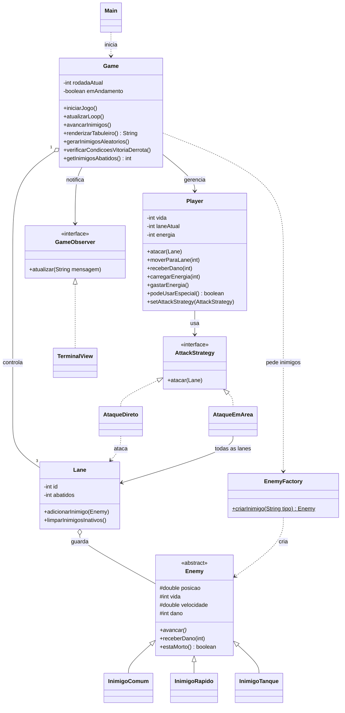

# Lane Combat Game

## 1. Sobre o jogo

Lane Combat Game é um jogo de terminal feito em Java. Inimigos nascem no topo de um tabuleiro com três colunas (lanes) e descem uma casa por vez até chegar ao jogador, que fica na base. Em cada rodada o jogador decide o que fazer: trocar de lane, atacar ou, quando a energia estiver cheia, soltar um ataque que acerta todas as lanes.

O que muda de uma partida para outra é a ordem em que os inimigos aparecem: lane e tipo são sorteados, então não há dois jogos iguais.

O projeto serve como exercício de Programação Orientada a Objetos, com herança, polimorfismo e três padrões de projeto aplicados a problemas reais do jogo.

### O que o projeto entrega

- Jogável pelo terminal, com tabuleiro desenhado em texto.
- Três tipos de inimigos com comportamentos diferentes.
- Ataque comum e ataque especial que depende de energia.
- Padrões de projeto: Strategy, Factory e Observer.
- Diagrama de classes em UML.
- Registro do uso de IA no desenvolvimento.

### Tecnologias

- **Java** (JDK 8 ou superior)
- **Mermaid** para o diagrama
- Sem Maven: a compilação e a execução usam apenas `javac` e `java`

---

## 2. Como jogar

### Objetivo

- **Vencer:** abater 15 inimigos.
- **Perder:** ficar com 0 de vida (o jogador começa com 100).

### Controles

| Tecla | O que faz |
|---|---|
| `1`, `2`, `3` | Move o jogador para a lane escolhida |
| `0` | Ataque direto na lane em que o jogador está |
| `9` | Ataque em área (só com energia em 100%) |

Qualquer outra entrada faz o jogador perder a vez. Escolher `9` sem energia só dá um aviso e deixa o jogador escolher de novo.

### Como o tabuleiro aparece

```text
      | Lane 1     | Lane 2     | Lane 3     |
--------------------------------------------------------
10    | [ * ]      | .          | [ >> ]     |
 9    | .          | .          | .          |
...
 0    | .          | .          | .          |
--------------------------------------------------------
 J    | \0/        |            |            |
========================================================
```

| Símbolo | Significado |
|---|---|
| `[ * ]` | Inimigo comum |
| `[ >> ]` | Inimigo rápido |
| `[ ** ]` | Inimigo tanque |
| `[ * ]x2` | Dois inimigos do mesmo tipo na mesma casa |
| `\0/` | O jogador |

### Ordem de cada rodada

1. Todos os inimigos andam.
2. Em rodadas pares, um novo inimigo nasce na linha 10.
3. O tabuleiro é mostrado com vida, energia e abates.
4. O jogador ganha 25% de energia.
5. O jogador escolhe a ação.

---

## 3. Regras e números do jogo

### Inimigos

| Tipo | Vida | Passo por rodada | Dano no jogador | Chega ao jogador em |
|---|---:|---:|---:|---:|
| Comum | 100 | 1,0 | 10 | 10 rodadas |
| Rápido | 50 | 2,0 | 3 | 5 rodadas |
| Tanque | 250 | 0,5 | 20 | 20 rodadas |

Quando um inimigo chega à linha 0, ele tira vida do jogador uma única vez e sai do tabuleiro. Esse inimigo não conta como abate.

### Sorteio dos inimigos

- A lane é escolhida ao acaso entre as três.
- Tipo: 55% comum, 25% rápido, 20% tanque.
- Se o sorteio der tanque duas vezes seguidas, o segundo vira comum.
- Um inimigo já nasce no início da partida.

### Ataques

| Ataque | Dano | Alcance |
|---|---:|---|
| Direto | 50 | Só o inimigo mais próximo do jogador na lane atual |
| Em área | 30 | Todos os inimigos das três lanes |

O ataque direto mira o inimigo mais próximo, e não o mais antigo, porque um inimigo rápido pode passar na frente de um comum.

### Energia

- Sobe 25% por rodada, até 100%.
- Com 100% o ataque em área fica liberado, o que acontece a partir da 4ª rodada.
- Ao usar o ataque em área, a energia volta a 0.

### Posição inicial do jogador

O jogador começa na lane 1.

---

## 4. Arquitetura

### 4.1. Pacotes

| Pacote | Conteúdo |
|---|---|
| `com.game` | `Main`, que só cria o `Game` e inicia a partida |
| `com.game.core` | `Game` (controla a partida) e `Lane` (guarda os inimigos de uma pista) |
| `com.game.model` | `Player`, `Enemy` e os três tipos de inimigo |
| `com.game.factory` | `EnemyFactory` |
| `com.game.strategy` | `AttackStrategy`, `AtaqueDireto` e `AtaqueEmArea` |
| `com.game.observer` | `GameObserver` e `TerminalView` |

### 4.2. Responsabilidade de cada classe

- **`Game`:** laço principal, sorteio de inimigos, leitura do teclado, desenho do tabuleiro e checagem de vitória e derrota.
- **`Lane`:** lista de inimigos de uma pista, remoção dos que morreram ou chegaram ao fim e contagem de abates.
- **`Player`:** vida, lane atual, energia e a estratégia de ataque ativa.
- **`Enemy`:** posição, vida, velocidade e dano. As subclasses só definem os valores e o jeito de andar.

### 4.3. Diagrama de classes



---

## 5. Padrões de projeto

### 5.1. Strategy: tipos de ataque

**Problema:** o jogador tem mais de um jeito de atacar, e cada um age de forma diferente (um alvo contra todas as lanes).

**Solução:** `AttackStrategy` declara `atacar(Lane)`. `AtaqueDireto` e `AtaqueEmArea` implementam a interface, e `Player` guarda a estratégia atual e apenas chama `atacar`. Quando o jogador escolhe `0` ou `9`, o `Game` troca a estratégia com `setAttackStrategy`. O `AtaqueEmArea` recebe a lista das três lanes no construtor para poder atingir todas.

**Ganho:** um novo ataque é só uma nova classe que implementa a interface, sem mexer em `Player`.

### 5.2. Factory: criação de inimigos

**Problema:** o `Game` sorteia um tipo de inimigo e não deveria precisar conhecer cada construtor.

**Solução:** `EnemyFactory.criarInimigo(String tipo)` recebe `"comum"`, `"rapido"` ou `"tanque"` (sem diferenciar maiúsculas de minúsculas) e devolve um `Enemy`. Um tipo desconhecido gera `IllegalArgumentException`. É uma fábrica simples, com método estático.

**Ganho:** o `Game` trabalha só com o tipo `Enemy`. Para criar um inimigo novo, basta a classe e mais um caso na fábrica.

### 5.3. Observer: mensagens do jogo

**Problema:** o `Game` precisa avisar eventos (inimigo que apareceu, jogador que se moveu, fim de jogo) sem decidir como isso vai ser mostrado.

**Solução:** `GameObserver` define `atualizar(String mensagem)`. `TerminalView` implementa a interface e imprime a mensagem com o prefixo `[CONSOLE LOG]`. O `Game` só conhece a interface.

**Ganho:** trocar a saída por outra (arquivo, interface gráfica) não exige alterar as regras do jogo.

### 5.4. Resumo

| Padrão | Classes | Para que serve no jogo |
|---|---|---|
| Strategy | `AttackStrategy`, `AtaqueDireto`, `AtaqueEmArea` | Trocar o ataque do jogador |
| Factory | `EnemyFactory` | Criar o inimigo sorteado |
| Observer | `GameObserver`, `TerminalView` | Mostrar os eventos da partida |

---

## 6. Uso de inteligência artificial

Ferramentas de IA foram usadas como apoio durante o desenvolvimento: para conversar sobre a organização das classes, investigar bugs e escrever esta documentação. As decisões finais e a revisão do código são de responsabilidade da autora.

---

## 7. Como rodar o jogo

Requisito: JDK instalado (`javac` e `java` disponíveis no terminal).

Na raiz do projeto:

```bash
mkdir -p out
javac -encoding UTF-8 -d out $(find src -name "*.java")
java -cp out com.game.Main
```

---

## 8. Estrutura de pastas

```text
LaneCombatGame/
├── src/com/game/
│   ├── Main.java
│   ├── core/
│   │   ├── Game.java
│   │   └── Lane.java
│   ├── factory/
│   │   └── EnemyFactory.java
│   ├── model/
│   │   ├── Enemy.java
│   │   ├── InimigoComum.java
│   │   ├── InimigoRapido.java
│   │   ├── InimigoTanque.java
│   │   └── Player.java
│   ├── observer/
│   │   ├── GameObserver.java
│   │   └── TerminalView.java
│   └── strategy/
│       ├── AttackStrategy.java
│       ├── AtaqueDireto.java
│       └── AtaqueEmArea.java
└── README.md
```